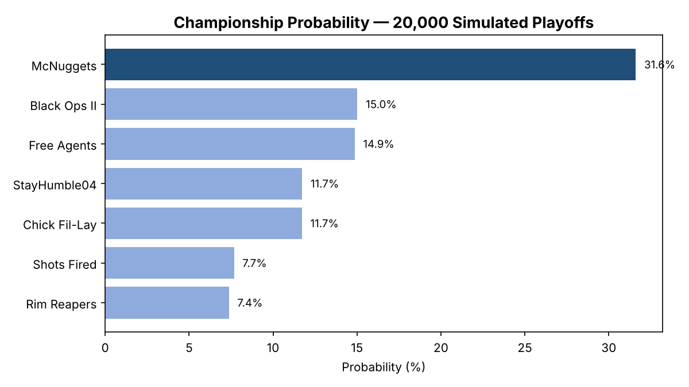
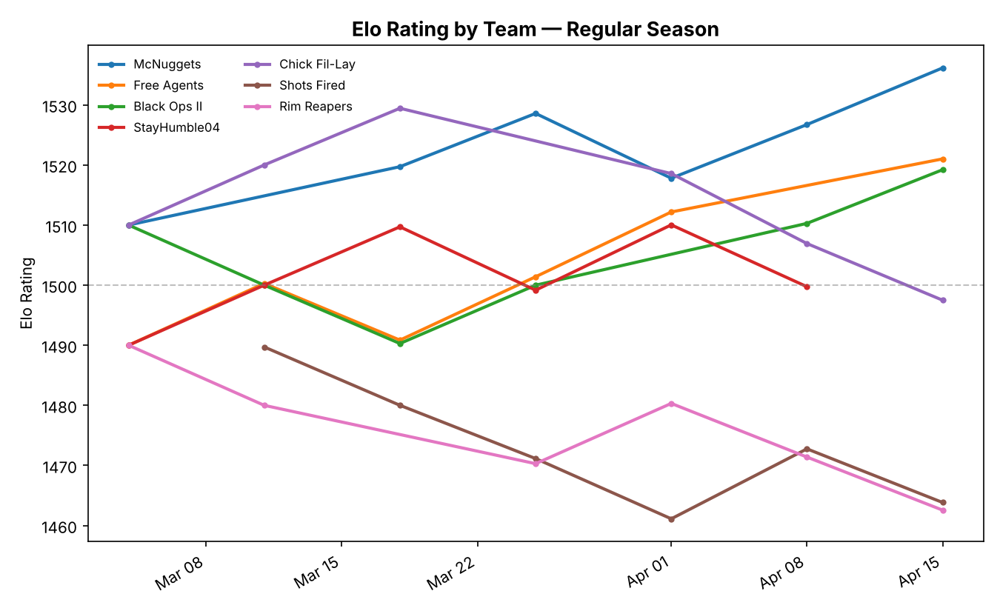

# YLeague Playoff Predictor

A Python project that rates the teams in my men's rec basketball league and simulates the
playoffs to estimate each team's championship odds.

I tracked every game of our 2026 season in a spreadsheet (7 teams, 27 games, 71 players).
Before the playoffs, I wanted to know which team actually had the best chance of winning
the title, not just which team had the best record. This project answers that using Elo
ratings and Monte Carlo simulation.

## Features

- **Elo ratings** for every team based on regular season results
- **Playoff simulation** that plays out the bracket 20,000 times to estimate championship odds
- **Player stats** including efficiency, consistency, recent form, and best game
- **Season awards** for players and teams
- **Charts** for rating history, championship odds, and player trends

## Results



McNuggets entered the playoffs as the favorite at 31.6% and went on to win the championship,
beating Free Agents 65-57 in the final.

Even as the favorite, the model gave them less than a one-in-three chance. Each team played
only 6 regular season games, so the ratings stayed close together and the odds were spread
fairly evenly across the league.



## How it works

- **Elo ratings:** Every team starts at 1500. After each game, the winner gains points and
  the loser loses the same amount. Upsets move ratings more than expected wins.
- **Seeding:** Teams are seeded by wins, then point differential, then total points, matching
  the league's tiebreakers.
- **Simulation:** Each game is decided by a random draw weighted by the teams' Elo win
  probabilities. The bracket re-seeds every round and the top seed gets a bye, matching the
  league's real playoff format. Repeating this 20,000 times gives each team's championship odds.

## How to run

```bash
pip install -r requirements.txt

python main.py ratings              # Elo ratings and rating history chart
python main.py simulate             # championship odds
python main.py player "Player 04"   # one player's stats and trend chart
python main.py awards               # player awards
python main.py team-awards          # team awards

pytest                              # run the tests
```

## Project structure

| File | Purpose |
|---|---|
| `data.py` | Loads the league spreadsheet |
| `elo.py` | Elo rating system |
| `bracket.py` | Seeding and playoff simulation |
| `player_stats.py` | Player stats and profiles |
| `team_stats.py` | Team awards and player win impact |
| `visualize.py` | Charts |
| `main.py` | Command-line interface |
| `test_*.py` | 17 tests using pytest |

Player names in the dataset are anonymized.
